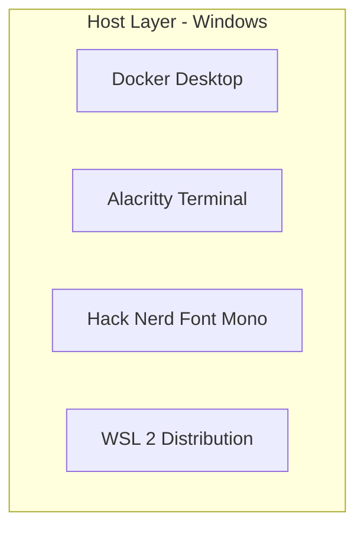
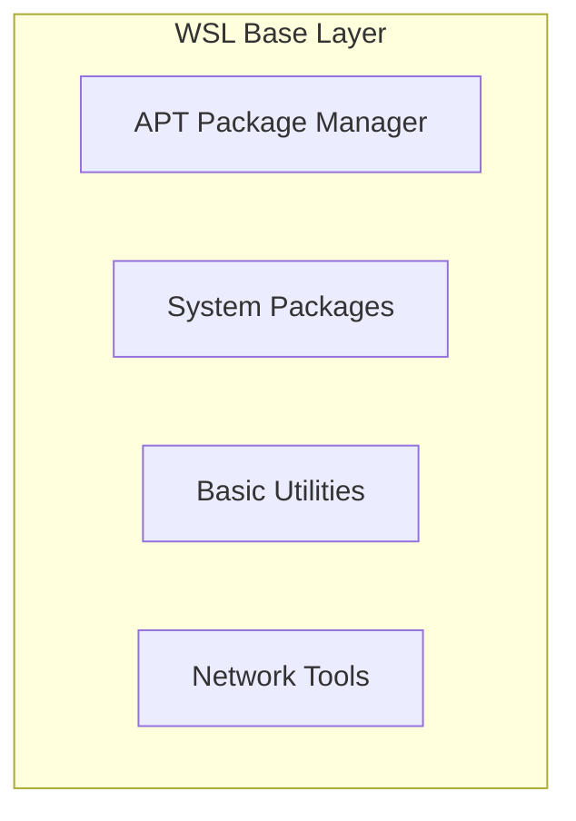
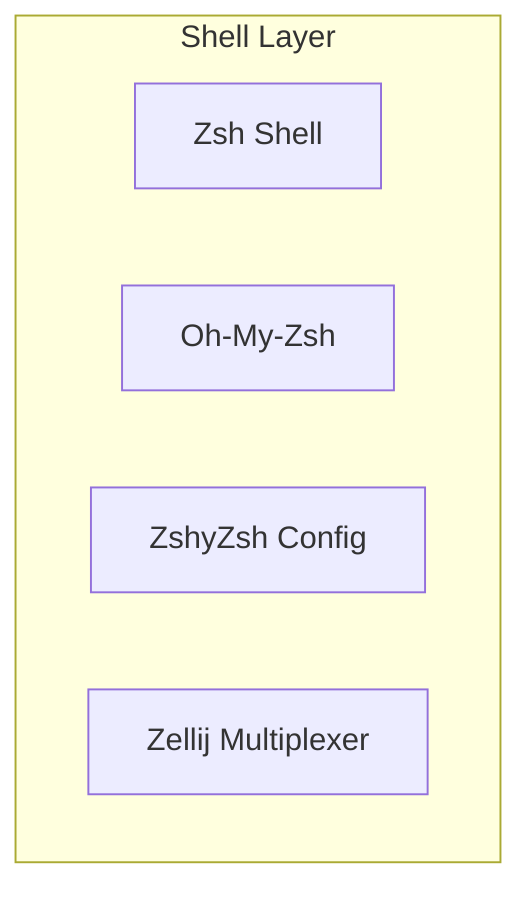
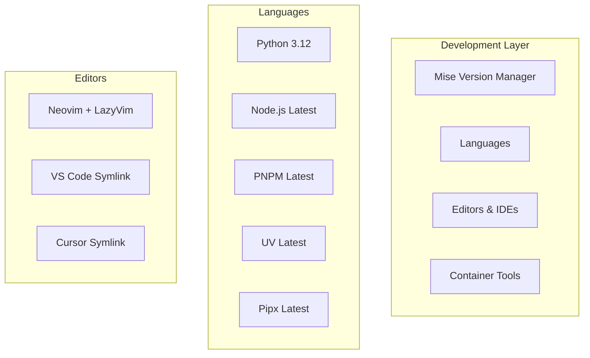
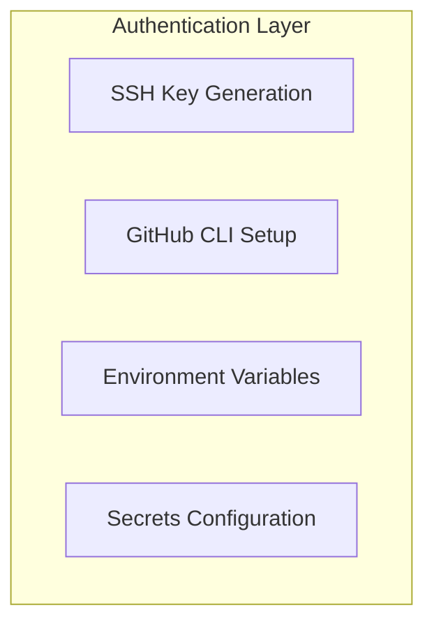
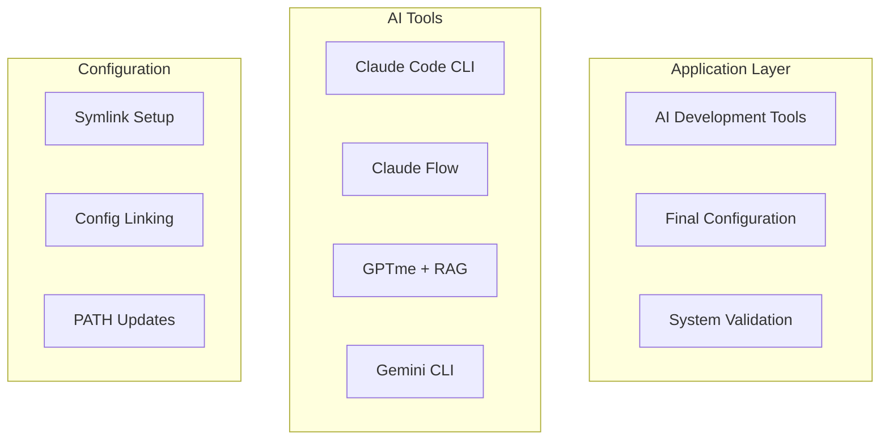

# WSL Provisioning Topology Design

## Architecture Overview

This document defines the layered topology for WSL environment provisioning, designed to minimize dependencies, maximize parallel execution, and ensure clean separation of concerns.

## Topology Layers

### Layer 1: Host Layer (Windows)
**Responsibility**: Windows-side applications and system configuration
**Dependencies**: None (Windows OS only)
**Parallel Execution**: All components can be installed simultaneously



**Components**:
- Docker Desktop (with WSL 2 backend)
- Alacritty terminal emulator
- Hack Nerd Font Mono
- WSL 2 Ubuntu distribution

**Validation Point**: 
- WSL 2 accessible via `wsl --status`
- Docker Desktop integrated with WSL
- Alacritty configured for WSL access
- Font available in Windows font registry

---

### Layer 2: WSL Base Layer (Ubuntu Foundation)
**Responsibility**: Core Ubuntu system and essential packages
**Dependencies**: Layer 1 (WSL 2 must be installed)
**Parallel Execution**: System packages can be installed in batches



**Components**:
- System package updates (`apt update && apt upgrade`)
- Essential packages: `curl`, `wget`, `unzip`, `tar`, `make`
- Network utilities: `ping`, `netstat`
- Text processing: `grep`, `jq`
- Development basics: `git`, `vim`, `neovim`

**Validation Point**:
- All packages successfully installed
- Git version ≥2.34
- Neovim version ≥0.11.0

---

### Layer 3: Shell Layer (Shell Environment)
**Responsibility**: Shell configuration and customization
**Dependencies**: Layer 2 (git and curl required)
**Parallel Execution**: zsh installation and oh-my-zsh setup can run concurrently



**Components**:
- Zsh shell installation and default shell configuration
- Oh-my-zsh framework installation
- Custom zshyzsh configuration clone and setup
- Zellij terminal multiplexer
- Shell environment variables and PATH configuration

**Validation Point**:
- Zsh is default shell
- Oh-my-zsh plugins active: git, docker, python
- ZSH_CUSTOM points to ~/.config/zshyzsh
- Zellij available and configured

---

### Layer 4: Development Layer (Languages & Tools)
**Responsibility**: Programming languages, version managers, and development tools
**Dependencies**: Layer 3 (shell environment must be configured)
**Parallel Execution**: mise installation and language installations can be parallelized



**Components**:
- Mise version manager installation and configuration
- Python 3.12 via mise
- Node.js latest via mise
- PNPM latest via mise
- UV package manager via mise
- Pipx installation via mise
- Neovim with LazyVim configuration
- VS Code and Cursor symlinks to Windows executables

**Validation Point**:
- Mise experimental mode enabled
- All language versions match specifications
- Neovim LazyVim loads without errors
- Symlinks resolve correctly

---

### Layer 5: Authentication Layer (Security & Access)
**Responsibility**: Authentication setup and credential management
**Dependencies**: Layer 4 (GitHub CLI and programming languages required)
**Parallel Execution**: SSH key generation and GitHub CLI setup can run in sequence



**Components**:
- SSH key generation (ed25519, no passphrase)
- GitHub CLI authentication with PAT
- SSH key addition to GitHub account
- Environment variables setup in secrets.zsh
- SSH agent configuration

**Validation Point**:
- `gh auth status` shows authenticated
- `ssh -T git@github.com` succeeds
- Environment variables available in new sessions
- SSH agent loads keys automatically

---

### Layer 6: Application Layer (AI Tools & Final Configuration)
**Responsibility**: AI development tools and final system configuration
**Dependencies**: Layer 5 (authentication and environment must be complete)
**Parallel Execution**: All AI tools can be installed simultaneously



**Components**:
- Claude Code CLI installation and authentication
- Claude Flow npm package
- GPTme installation via pipx with [all] extras
- GPTme RAG extension
- Gemini CLI installation
- Configuration file linking
- Final PATH and environment setup
- MCP configuration for Claude Code

**Validation Point**:
- All AI tools respond to `--version` commands
- Claude Code authentication validates
- GPTme configuration properly linked
- All symlinks functional
- Docker integration working

## Parallel Execution Opportunities

### Within Layer 1 (Host - Windows)
```powershell
# All can run simultaneously
Start-Process "DockerDesktopInstaller.exe"
Start-Process "AlacrittyInstaller.exe" 
Start-Process "FontInstaller.exe"
Start-Process "wsl --install Ubuntu"
```

### Within Layer 2 (WSL Base)
```bash
# Package installations can be batched
sudo apt update && sudo apt install -y \
  curl wget unzip tar make \
  ping netstat grep jq \
  git vim neovim \
  build-essential
```

### Within Layer 3 (Shell)
```bash
# Parallel shell setup
(
  # Terminal 1: Install zsh and oh-my-zsh
  sudo chsh -s $(which zsh) &&
  sh -c "$(curl -fsSL https://raw.githubusercontent.com/ohmyzsh/ohmyzsh/master/tools/install.sh)"
) &

(
  # Terminal 2: Clone zshyzsh configuration
  git clone https://github.com/YIC-Triumph/zshyzsh ~/.config/zshyzsh
) &

(
  # Terminal 3: Install zellij
  ~/.config/zshyzsh/scripts/install-zellij.sh
) &

wait
```

### Within Layer 4 (Development)
```bash
# Parallel language installations via mise
mise install python@3.12 &
mise install nodejs@latest &
mise install pnpm@latest &
mise install uv@latest &
mise install pipx@latest &
wait

# Set all versions simultaneously
mise use python@3.12 nodejs@latest pnpm@latest uv@latest pipx@latest --global
```

### Within Layer 6 (Applications)
```bash
# Parallel AI tool installations
npm install -g @anthropic-ai/claude-code &
npm install -g claude-flow@latest &
npm install -g @google/gemini-cli@latest &
pipx install 'gptme[all]' &
pipx install gptme-rag &
wait
```

## Dependency Matrix

| Layer | Depends On | Blocks | Parallel Within Layer |
|-------|------------|--------|----------------------|
| 1: Host | Windows OS | Layers 2-6 | ✅ Full parallel |
| 2: WSL Base | Layer 1 | Layers 3-6 | ✅ Package batching |
| 3: Shell | Layer 2 | Layers 4-6 | ✅ Concurrent setup |
| 4: Development | Layer 3 | Layers 5-6 | ✅ Language parallel |
| 5: Authentication | Layer 4 | Layer 6 | ⚠️ Sequential (security) |
| 6: Applications | Layer 5 | None | ✅ Full parallel |

## Failure Recovery Points

### Layer 1 Failures
- **Docker Desktop**: Retry installation, check Windows version compatibility
- **WSL 2**: Enable virtualization in BIOS, check Windows features
- **Fonts**: Manual installation, verify font registry

### Layer 2 Failures  
- **Package installation**: Update package lists, resolve dependency conflicts
- **Network issues**: Check WSL networking, DNS resolution

### Layer 3 Failures
- **Shell change**: Manual chsh, verify user permissions
- **Oh-my-zsh**: Clean installation directory, retry installation
- **Zshyzsh clone**: Check GitHub access, SSH vs HTTPS

### Layer 4 Failures
- **Mise installation**: Manual installation, PATH verification
- **Language versions**: Clear mise cache, retry installations
- **Symlinks**: Verify Windows executable paths, permissions

### Layer 5 Failures
- **SSH keys**: Regenerate keys, check GitHub settings
- **GitHub CLI**: Re-authenticate, verify token permissions
- **Environment variables**: Manual file editing, shell reload

### Layer 6 Failures
- **AI tools**: NPM/pipx cache clearing, manual installations
- **Authentication**: Token refresh, manual configuration
- **Final configuration**: Manual linking, permission fixes

## Quality Gates

### Between Layers
Each layer must pass validation before proceeding to the next:

1. **Host → WSL Base**: WSL 2 accessible, Docker integrated
2. **WSL Base → Shell**: All packages installed, Git functional
3. **Shell → Development**: Zsh default, oh-my-zsh active
4. **Development → Authentication**: Mise working, languages available
5. **Authentication → Applications**: GitHub authenticated, SSH working
6. **Applications → Complete**: All tools functional, full integration

### Final System Validation
```bash
# Comprehensive system check
./validate-environment.sh
```

## Performance Characteristics

### Estimated Installation Times
- **Layer 1**: 10-15 minutes (Windows applications)
- **Layer 2**: 5-10 minutes (system packages)
- **Layer 3**: 3-5 minutes (shell configuration)
- **Layer 4**: 10-15 minutes (language installations)
- **Layer 5**: 2-3 minutes (authentication)
- **Layer 6**: 8-12 minutes (AI tools)

**Total Sequential**: 38-60 minutes
**Total with Parallelization**: 20-30 minutes (50% improvement)

### Resource Requirements
- **Network**: High bandwidth for parallel downloads
- **CPU**: Multi-core beneficial for parallel compilation
- **Memory**: 8GB+ recommended for simultaneous operations
- **Disk**: 10GB+ free space for all tools and languages

## Implementation Strategy

1. **Pre-flight Checks**: Verify Windows version, WSL 2 capability
2. **Layer-by-Layer Execution**: Strict dependency ordering
3. **Parallel Within Layers**: Maximize concurrent operations
4. **Validation Gates**: Quality checks between layers
5. **Error Recovery**: Graceful handling of partial failures
6. **Final Integration Test**: End-to-end system validation

This topology design ensures reliable, efficient WSL environment provisioning with clear separation of concerns and maximum parallelization opportunities.